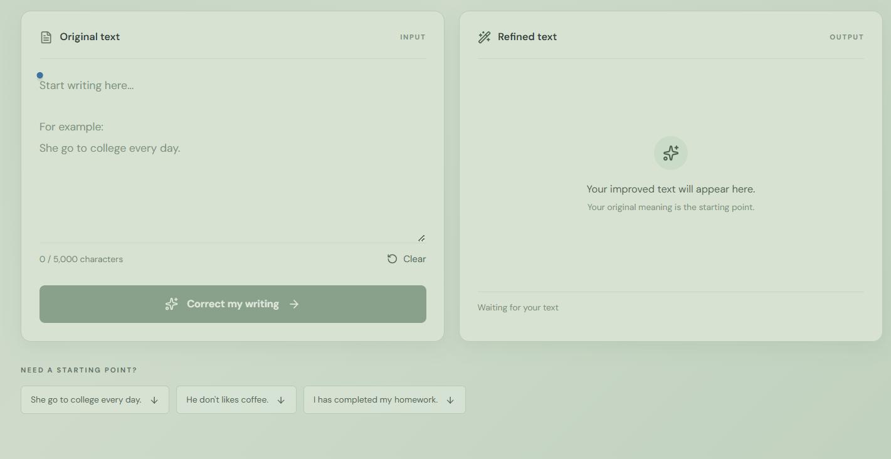
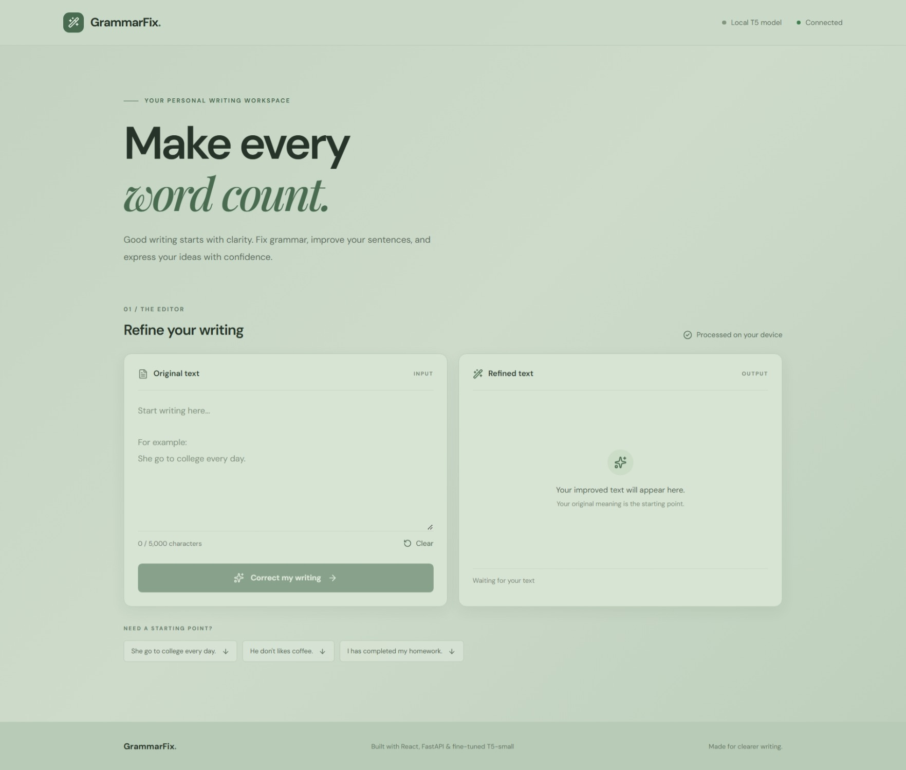
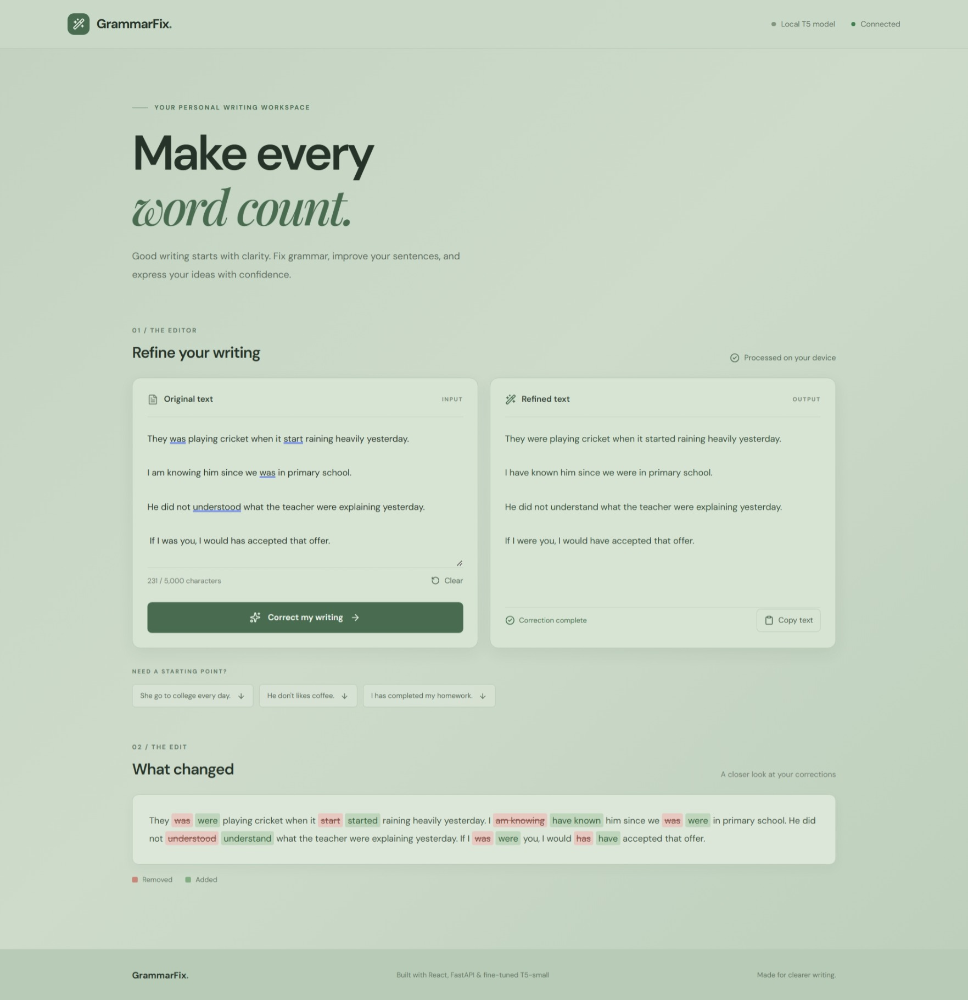
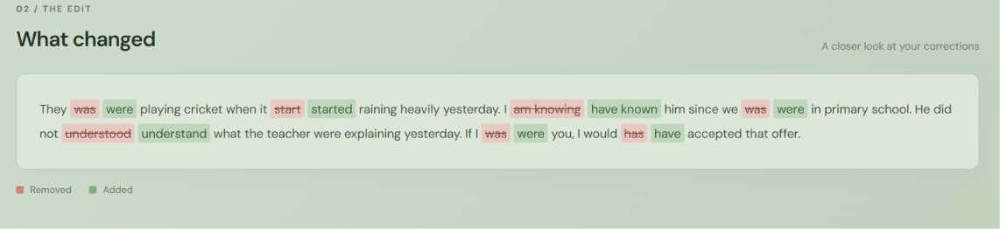

# GrammarFix — AI-Powered Grammar Auto-Correction

An NLP-based grammar correction application powered by a fine-tuned **T5-small Transformer model**. GrammarFix identifies grammatical errors and generates corrected text through a modern React interface and a locally running FastAPI backend.

The project explores transformer-based Natural Language Processing, model fine-tuning, model evaluation, and full-stack integration.

---

## 🚀 Project Demo

### 🎬 Application Preview



### 📸 Application Screenshots

**1. Home Interface**



**2. Grammar Correction Result**



**3. Highlighted Grammar Changes**



---

## ✨ Features

- **AI-Powered Grammar Correction:** Corrects grammatical errors using a fine-tuned T5-small model.
- **Multi-Sentence Support:** Processes multiple sentences and paragraphs.
- **Change Highlighting:** Displays deleted words in red and inserted words in green.
- **Modern React Interface:** Provides a clean, responsive writing workspace.
- **FastAPI Backend:** Provides REST API endpoints for communication between the frontend and ML model.
- **Local Model Inference:** Runs the trained model on your local machine.
- **Copy and Clear:** Easily copy corrected text or reset the editor.
- **Alternative Gradio Interface:** Retains the original Gradio application.

---

## 🛠️ Technology Stack

| Component | Technologies |
|---|---|
| Programming Languages | Python, JavaScript |
| NLP Model | T5-small |
| Deep Learning | PyTorch |
| NLP Framework | Hugging Face Transformers |
| Backend | FastAPI, Uvicorn |
| Frontend | React, Vite |
| Styling | Tailwind CSS |
| UI Icons | Lucide React |
| Text Comparison | Python difflib |
| Model Evaluation | JFLEG, GLEU |
| Version Control | Git, GitHub |

---

## 🏗️ System Architecture

```text
              USER
                |
                v
         REACT FRONTEND
       (Vite + Tailwind CSS)
                |
                | HTTP REST API
                v
         FASTAPI BACKEND
                |
                v
           MODEL MODULE
                |
                v
       FINE-TUNED T5-SMALL
                |
                v
         CORRECTED TEXT
                |
                v
        CHANGE HIGHLIGHTING
                |
                v
         REACT FRONTEND
```

The React frontend sends text to the FastAPI backend through HTTP requests.

The backend passes the input to the locally loaded T5-small model, receives the corrected output, and generates a highlighted comparison using Python's `difflib` module.

---

## 📁 Project Structure

```text
grammar-auto-correction/
│
├── backend/
│   ├── __init__.py
│   ├── main.py
│   └── model.py
│
├── frontend/
│   ├── public/
│   ├── src/
│   ├── index.html
│   ├── package.json
│   └── vite.config.js
│
├── models/
│   └── gec_t5_bea_final/
│
├── notebooks/
│
├── docs/
│   └── screenshots/
│       ├── home.jpeg
│       ├── correction-result.jpeg
│       ├── changes-highlight.png
│       └── grammarfix-demo.gif
│
├── app.py
├── requirements.txt
├── .gitignore
└── README.md
```

**Note:** Model weights are stored locally and excluded from GitHub. The `models/gec_t5_bea_final/` directory must contain the trained model and tokenizer files before running the application.

---

## 🧠 Model Training

The project uses the T5-small encoder-decoder Transformer architecture for grammatical error correction.

### Training Dataset

The current model was fine-tuned using the BEA-2019 Write & Improve and LOCNESS datasets.

| Parameter | Configuration |
|---|---|
| Base Model | T5-small |
| Training Dataset | BEA-2019 W&I + LOCNESS |
| Training Examples | 21,459 |
| Validation Examples | 2,691 |
| Epochs | 5 |
| Batch Size | 16 |
| Learning Rate | 0.0001 |
| Maximum Sequence Length | 128 |
| Training Environment | Google Colab (NVIDIA T4 GPU) |

### Training Results

| Epoch | Training Loss | Validation Loss |
|---|---:|---:|
| 1 | 0.447854 | 0.383847 |
| 2 | 0.421399 | 0.360651 |
| 3 | 0.394883 | 0.358265 |
| 4 | 0.370020 | 0.352821 |
| 5 | 0.353759 | 0.352388 |

The final selected checkpoint was saved after the fifth epoch.

### Model Evaluation

The model was evaluated on the JFLEG benchmark using GLEU.

| Evaluation Metric | Result |
|---|---:|
| Evaluation Examples | 755 |
| GLEU (Whitespace Tokenization) | 0.595 |
| GLEU (Moses Tokenization + Normalization) | 0.7822 |

**Note:** GLEU scores depend on tokenization and normalization settings. Scores produced using different evaluation configurations should not be directly compared.

---

## ⚙️ Installation and Local Setup

### Prerequisites

- Python 3.10 or later
- Node.js and npm
- Git
- Trained model and tokenizer files

### 1. Clone the Repository

```bash
git clone https://github.com/iamshubham18/grammar-auto-correction.git

cd grammar-auto-correction
```

### 2. Set Up the Python Environment

Create a virtual environment:

```bash
python -m venv .venv
```

Activate it on Windows PowerShell:

```powershell
.venv\Scripts\Activate.ps1
```

Install Python dependencies:

```bash
pip install -r requirements.txt
```

### 3. Add the Trained Model

Place the trained model and tokenizer files inside:

```text
models/gec_t5_bea_final/
```

The model weights are not included in this GitHub repository. You must have authorized access to the trained model files locally.

### 4. Start the FastAPI Backend

From the project root, run:

```bash
python -m uvicorn backend.main:app --host 127.0.0.1 --port 8000
```

Backend URL:

http://127.0.0.1:8000

Interactive API documentation:

http://127.0.0.1:8000/docs

### 5. Start the React Frontend

Open another terminal:

```bash
cd frontend
```

Install frontend dependencies:

```bash
npm install
```

Start the development server:

```bash
npm run dev
```

Frontend URL:

http://localhost:5173

The frontend communicates with the FastAPI backend running locally.

---

## 🔌 API Endpoints

| Method | Endpoint | Description |
|---|---|---|
| GET | `/api/health` | Checks backend availability |
| POST | `/api/correct` | Corrects the submitted text |

### Example Request

```json
{
  "text": "She go to college every day."
}
```

### Example Response

```json
{
  "status": "success",
  "original": "She go to college every day.",
  "corrected": "She goes to college every day.",
  "highlighted_html": "..."
}
```

The highlighted HTML represents the differences between the original and corrected text using deletion and insertion tags.

---

## 🖥️ Alternative Gradio Interface

The original Gradio application is also available.

From the project root, run:

```bash
python app.py
```

Open the local Gradio URL displayed in the terminal, typically:

http://127.0.0.1:7860

---

## ⚠️ Current Limitations

- The model may not identify every grammatical error.
- Some corrections may introduce semantic changes or miss the intended meaning.
- The current model input length is limited to 128 tokens, so longer inputs may be truncated.
- Model inference speed depends on the available hardware.
- The application currently runs locally and requires the trained model files.

---

## 📜 Dataset Licensing

The BEA-2019 W&I and LOCNESS datasets have usage and redistribution restrictions. In particular, LOCNESS has restrictions on third-party redistribution.

The trained model weights are therefore not distributed through this repository. Public model hosting or public inference deployment requires appropriate authorization for the datasets and resulting model use.

---

## 🔮 Future Improvements

- Improve correction accuracy through further model experimentation.
- Evaluate using additional grammar correction benchmarks.
- Improve handling of longer documents.
- Add more comprehensive automated tests.
- Optimize inference performance.
- Explore deployment options after resolving dataset licensing requirements.

---

## 👨‍💻 Author

**Shubham Kumar Verma**

B.Tech Computer Science and Engineering  
Reva University

- **GitHub:** [@iamshubham18](https://github.com/iamshubham18)
- **Project Repository:** [Grammar Auto-Correction](https://github.com/iamshubham18/grammar-auto-correction)

---

*Built as a hands-on project exploring Natural Language Processing, Transformer fine-tuning, and full-stack application development.*